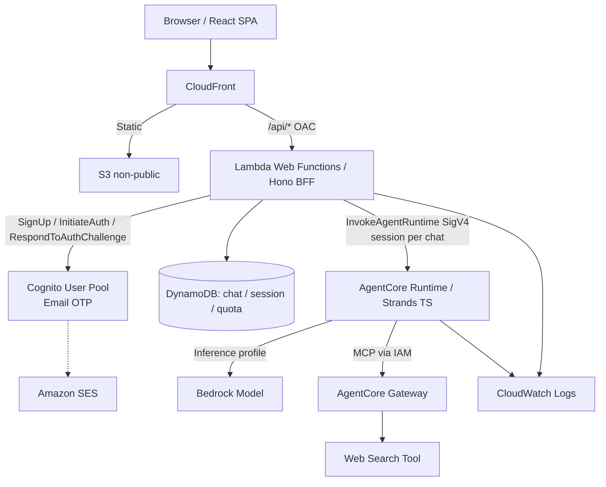

# AIチャットWebアプリ スターターキット 技術詳細仕様書

**文書ID:** TECH-AICHAT-001  
**版:** v2.1 / 認証をメールアドレスのパスワードレス認証（自前1画面）に一本化  
**作成日:** 2026-10-29  
**位置づけ:** **スターターキット**。利用者が自分のAWSアカウントへデプロイし、拡張して使う前提の雛形  
**対象:** AWS上に構築するChatGPT風のテキストチャットWebサービス  
**コード言語:** **TypeScript統一**（フロントエンド・API・エージェント・IaC・テスト・ビルドスクリプト）  
**対象リージョン:** データ保存・アプリ実行は原則 `ap-northeast-1`（東京）。CloudFront・IAM等のグローバルサービス、およびBedrockの推論プロファイルによるリージョン外推論は例外（§1.4）。WAFはオプションで、有効時はCloudFront用の`us-east-1`管理が必要  
**ステータス:** 実装用設計ドラフト。Phase 0のPoC関門（§15）を通過するまで、AWS固有部分は未検証扱い

> この文書は**実装用技術仕様書（設計ドラフト）**であり、動作検証済み実装ではありません。サンプルコードは契約・構造例です。Lambda Web Functions、AgentCore Runtime/Gateway、CognitoのメールOTP（SDK経由）、CloudFront越しのSSEは、Phase 0のPoC関門でAWS dev環境にて検証します。CI/CDの有無とは無関係に、ローカルテストは必須です。

## 0. v1.1からの主な変更（アーキテクチャレビューの決定事項）

| # | 論点 | v2.0での決定 |
|---|---|---|
| D1 | 推論リージョン | 明確な要件なし。コストと性能を優先し、**Global / JP推論プロファイルも選定対象**。会話データの保存とログは東京 |
| D2 | 利用者 | **セルフサインアップ**（メール検証必須） |
| D3 | 認証方式 | **メールアドレスのパスワードレス認証（メールOTP）に一本化**。新規・既存共通の**自前1画面**（メール入力→コード入力）。Managed Login・パスキー・パスワード・TOTP・MFAは採用しない（v2.1で変更） |
| D4 | 外部IdP | Googleログインは**採用しない**（将来拡張候補として記載のみ） |
| D5 | BFF実行基盤 | **Lambda Web Functions**。PoC関門を設け、不合格時は**Lambda Function URL + Response Streaming**へ切替 |
| D6 | ドメイン | **AWS標準ドメインで開始**。独自ドメイン移行時の再ログインを許容（パスキー不採用のため再登録は発生しない） |
| D7 | AgentCoreセッション | **会話ごとに1セッション**、アイドルタイムアウト初期値**5分** |
| D8 | 全体コスト上限 | **実装しない**（スターターキットのため）。ユーザー単位クォータは設定値で調整可能 |
| D9 | ローカル基盤 | **MiniStack + TesterArmy `e2e`**（タグ＋ダイジェストで固定） |
| D10 | 異常終了時の回復 | **次回アクセス時の遅延回復のみ**。中断・失敗した生成もクォータは**消費扱い** |
| D11 | `pnpm test` | **1コマンドでMiniStack起動からE2Eまで完結** |
| D12 | 観測 | **構造化ログ＋最低限のアラームのみ**。AgentCore Observabilityは拡張手順の紹介に留める |
| D13 | その他 | タイトルは最初の発言の先頭30文字、退会はスクリプト、**ユーザー単位の全セッション失効は実装しない** |
| D14 | 認証の実装方針 | **自前実装を最小化**。OTPの生成・送信・有効期限・試行回数はCognitoに任せ、BFFはCognito API（`SignUp`/`ConfirmSignUp`/`InitiateAuth`/`RespondToAuthChallenge`）の呼び分けとセッション発行のみ行う。ID Token検証は`aws-jwt-verify` |

**v2.1の背景:** Managed Loginのサインアップ画面は、パスワードレスのサインインを許可していてもパスワード入力を要求する（AWS公式ドキュメントで確認）。「メールアドレスを入れるだけ」の体験を実現するため、Managed Loginをやめ、SDK経由の自前1画面に一本化した。これによりOAuthリダイレクト・PKCE・callbackが不要になった。

その他、整合性確保のための変更：ユーザー単位の同時実行制限を削除（チャット単位1本のみ）、時間単位クォータ用のキーを追加、クォータ日付境界をJSTに確定、SSEハートビートを必須化。

## 1. 概要・設計判断

### 1.1 目的

React/Vite製のChatGPT風テキストチャットWebアプリの**スターターキット**を、AWS東京リージョン中心に構築する。ブラウザには認証トークンを渡さず、**メールアドレスとワンタイムコードだけのパスワードレス認証（Cognito＋BFF）+ BFFセッション**で安全にログインする。AI処理には**Strands Agents TypeScript SDKをAmazon Bedrock AgentCore Runtimeにデプロイ**し、**AgentCore GatewayのWeb Search Toolをデフォルト有効**にする。

**最優先の開発要件:** `pnpm dev`および`pnpm test`を、AWS認証情報・外部LLM APIキー・インターネットに依存せず**MiniStackとローカルのモックで完結**させる。初回の依存物・Dockerイメージの取得は事前準備に該当する。キット利用者が「clone → `pnpm install` → `pnpm test`」で迷わず動かせることを品質目標とする。

### 1.2 スコープ／オプション

| 機能 | 標準 | 実装判断 |
|---|---|---|
| React/Vite、Hono BFF、Cognito、DynamoDB | 必須 | 認証・会話管理の基盤 |
| Strands Agents TypeScript + AgentCore Runtime | 必須 | AI実行をBFFから分離 |
| AgentCore Gateway Web Search | **必須・ON** | Web検索のみを許可、ソースURL/タイトル/日付を引用表示 |
| ローカルMiniStack / ローカルAgentRunner | **必須** | AWSを呼ばない完全ローカル動作 |
| フロント・バックのUnitテスト | **必須** | Vitest + React Testing Library |
| バックエンドAPI結合テスト | **必須** | Hono HTTP → Repo → MiniStack → Fake AgentRunner |
| システム全体E2E | **必須** | TesterArmy **`e2e`** + ローカルブラウザ |
| AWS Budgets | **任意・OFF** | `enableBudgets`でCDK資源を追加 |
| CI/CD（GitHub Actions） | **任意・OFF** | `enableCiCd`でテンプレート/OIDCを有効化 |
| AWS WAF | **任意・OFF** | `enableWaf`、CloudFront用管理は`us-east-1` |
| 独自ドメイン | **任意・OFF** | AWS標準ドメインで開始。移行手順は§4.5 |
| パスキー | **対象外** | 将来、独自ドメイン導入時に追加を検討（§16） |
| AgentCore Memory/Browser/Code Interpreter/外部MCP/Observability | **対象外** | セキュリティとコスト、構成の単純さのため当初は追加しない |
| Googleログイン等の外部IdP | **対象外** | 将来拡張候補（§16） |
| サービス全体のコスト上限（キルスイッチ） | **対象外** | キット利用者が公開運用時に検討（READMEで案内） |

**MVP機能:** メールアドレスとワンタイムコードだけで行うサインアップ/ログイン（新規・既存共通の1画面）、会話CRUD、テキスト生成/SSE、Web検索ソース表示、ユーザー別クォータ、ログ、管理者スクリプトによるユーザーデータ削除。

**MVP非対象:** ファイル・画像・音声、任意URLのブラウジング、shell/コード実行、エージェントによる副作用操作、チーム共有、課金、外部サービスへの接続、退会の画面機能、ユーザー単位の全セッション即時失効。

### 1.3 構成要素

| 区分 | コンポーネント | 補足 |
|---|---|---|
| Web | React + Vite + TypeScript strict / Tailwind / TanStack Query | SPA |
| API/BFF | Hono + TypeScript / **Lambda Web Functions** Node.js 24 Arm64 | パスワードレス認証API・セッション・権限・クォータ・SSE中継。代替：Lambda Function URL + Response Streaming |
| AI Runtime | **Amazon Bedrock AgentCore Runtime**（Node.jsの直接コードデプロイ） | Strands実行の専用境界。TypeScript→JavaScriptビルド |
| エージェント | `@strands-agents/sdk` | Bedrockモデル/Tool loop/ストリーミング |
| Tools | **AgentCore Gateway + Web Search connector** (`connectorId: web-search`) | MCP。東京リージョン。connector 1.2.0固定を推奨 |
| モデル | Amazon Bedrock | In-Region / JP / Global推論プロファイルを含めてコストと性能で選定（§6.1） |
| DB | DynamoDB On-Demand（東京） | 会話・セッション・クォータの正本 |
| 認証 | Cognito User Pool（Essentials）をBFFからSDKで呼び出し / BFF Cookie | メールOTPのみ（パスワードレス）。Managed Loginは使わない。メール送信はSES。ID Token検証は`aws-jwt-verify` |
| 配信 | 非公開S3 + CloudFront + OAC | `/api/*`だけBFFへ。APIキャッシュ無効 |
| IaC | AWS CDK v2 + TypeScript | AgentCore・Web FunctionsはL1構成。optional stackを条件分岐 |
| ローカル | **MiniStack + Hono + ローカルStrands実行** | AgentCore Runtime/Gateway・Web Functionsはエミュレーション不可と明示 |
| テスト | Vitest / RTL / TesterArmy `e2e` | 4階層をAWSなしで実行 |

### 1.4 論理アーキテクチャ



- ブラウザにはCognitoのトークンを返さず、BFFが`__Host-session`を扱う。`/api/*`は同一オリジン、Cache Policy `CachingDisabled`。
- BFFからAgentCore Runtimeは**IAM/SigV4**で呼び、Runtimeエンドポイントをブラウザへ公開しない。BFFロールは指定RuntimeのInvoke/StopRuntimeSession権限のみ。
- AgentCore Runtimeロールは指定Bedrockモデル（推論プロファイルを含む）、指定AgentCore GatewayのMCPツール接続だけを許可。GatewayのサービスロールはWeb Search ToolのInvokeに限定。
- AgentCore Memoryは採用しない。**DynamoDBが会話履歴の正本**。AgentCoreセッションは**会話ごとに1つ**とし（§6.2）、セッション内の状態を永続記憶の根拠にしない。
- **データ所在の整理:** 会話データ（DynamoDB）・アプリログ（CloudWatch）は東京に保存する。**推論処理は選定した推論プロファイルにより東京以外（国内他リージョン・海外）で行われ得る**。Web検索クエリは検索事業者へ送られ得る。これらをキット利用者向けにREADMEとプライバシーポリシーの雛形に明記する。
- セキュリティ境界に**認証(BFF)→認可/クォータ(BFF)→モデル・ツール実行(AgentCore)**を設ける。

### 1.5 実行モードの規約

```ts
export type AppMode = 'local' | 'aws';
export type AgentBackend = 'local-strands' | 'agentcore';
export type SearchBackend = 'fixture' | 'agentcore-web-search';

// local: AgentRunnerはローカルプロセス、Web検索は固定fixture、SDKはMiniStackへ、認証はdev-auth
// aws: AgentRunnerはInvokeAgentRuntime、検索はAgentCore Gateway、認証はCognito
// 本番ではlocal-strands / fixture / dev-authを起動不可にする（fail-closed）
```

ローカル用`dev-auth`は`APP_MODE=local`でのみ使い、production buildに到達できないDI実装と起動時のfail-closed検証を行う。認証の強度をエミュレーター試験だけで保証したとみなさない。

## 2. 非機能要件・SLO（初期目標）

| 項目 | 目標 | 備考 |
|---|---|---|
| 対応ブラウザ | 最新のChrome, Safari, Edge, Firefox | モバイルブラウザもレスポンシブ対応 |
| 利用想定 | 小規模公開、同時アクティブ10〜100人 | キット利用者が負荷試験で再設定 |
| API稼働率 | 月間99.5%以上を目標 | マルチリージョン高可用性は範囲外 |
| 非AI API | p95 < 1秒（ウォーム時） | ネットワーク条件、DDB依存 |
| 初回AI表示 | p95 < 10秒（目標） | 会話内2回目以降はAgentCoreセッション再利用で短縮を見込む。初回はmicroVM起動を含めて実測 |
| 最大入力 | 4,000文字／メッセージ | Zodでバイト数・文字数とも検証 |
| 最大出力 | 2,048トークン | 使用モデルが対応する範囲で調整 |
| 1会話の参照履歴 | 直近10往復＋システムプロンプト | 検索結果を含めたトークン予算を§6.4で制御 |
| AI生成の上限 | 1回120秒 | SSEハートビート（15秒間隔）でCloudFrontの無通信タイムアウトを回避。PoCで実測 |
| 保存先 | 東京リージョン | 推論とWeb検索はリージョン外になり得る（§1.4） |
| RPO / RTO | RPO 24h / RTO 4hを目標 | PITR、手順検証、復旧試験が前提 |
| 個人情報 | 必要最小限 | 生テキスト・メールアドレス・ユーザーIDをログに出さない |

SLOは**設計目標**であり、利用サービスだけで自動保証されるものではない。

## 3. 画面仕様・UX

| 画面 | ルート例 | 主な機能 |
|---|---|---|
| ランディング | `/` | 未認証時はログイン画面へ、ログイン時はチャット画面へ誘導 |
| ログイン | `/login` | メールアドレス入力→コード入力の1画面（新規登録・ログイン共通） |
| チャット | `/chat/:chatId` | 左ナビ、メッセージ、入力欄、SSE表示、中断、再送 |
| 新規チャット | `/chat/new` | 入力送信時にチャット作成 |
| 設定 | `/settings` | ユーザー情報（メールアドレス）、ログアウト、使用量表示 |
| エラー | `/error` | 403/404/500、再試行と問い合わせ導線 |

**UI最低要件**
1. デスクトップは2カラム（サイドバー＋メイン）、スマホは折り畳みサイドバー。
2. メッセージの役割（user/assistant）、作成時刻、生成中状態を表示。
3. 応答中は入力の二重送信を止め、「生成を停止」ボタンで`AbortController`を使用。
4. AI出力のMarkdownはサニタイズして表示。HTMLは原則禁止。コードブロックはエスケープする。
5. リロード後に会話をDBから復元。異常終了した生成は`interrupted`として表示（§7.4の遅延回復による）。
6. 長い会話では前後のメッセージをページング。
7. アクセシビリティ：キーボード操作、フォーカス表示、適切なARIA、`aria-live=polite`。
8. Web検索が実行された場合は「Webを検索中」を表示。回答末尾または該当箇所に**出典タイトル・URL・公開日**を表示し、引用URLのスキームはhttps/httpのみ許容。
9. 検索に失敗しても検索未実施を明示し、未検証の最新情報を確定事項として表示しない。
10. クォータ超過（429）時は、上限に達したことと再開可能になる時刻（JST基準）を表示する。
11. ログイン画面は、メールアドレス入力→「コードを送信」→6桁コード入力→ログイン完了、の1画面2ステップとする。新規か既存かを画面上で区別しない。コード再送（クールダウン表示付き）とメールアドレスの入力し直しを提供する。
12. 会話タイトルは最初のユーザー発言の先頭30文字を自動設定し、ユーザーが変更できる（LLMは呼ばない）。

**SPAルーティング:** `/chat/:id`の直アクセスを可能にするため、CloudFront Functionのviewer-request rewriteをTypeScriptソースから生成する。`/api/*`・静的アセット・拡張子付きファイルは絶対に`index.html`へ書き換えない。CloudFront共通の403/404→200変換は**APIエラーも潰すため禁止**。

## 4. 認証・セッション仕様

### 4.1 認証方式

- 本番：Cognito User Pool（**Essentials**プラン）。**セルフサインアップ有効**、メールアドレスをユーザー名とし、**第1要素は`EMAIL_OTP`のみ**（選択型認証`USER_AUTH`）。`PASSWORD`・`WEB_AUTHN`・`SMS_OTP`は許可しない。MFAは`OFF`。
- **Managed Loginは使わない。** Managed Loginのサインアップ画面はパスワード入力を要求するため。認証画面はReactの自前1画面とし、BFFがCognito APIをSDKで呼ぶ。
- **自前実装の最小化:** OTPの生成・メール送信・有効期限・試行回数制限はCognitoに任せる。BFFの責務は、Cognito APIの呼び分け、Cognitoの`Session`文字列の一時保管、ID Token検証、アプリセッション発行に限る。
- **App Client:** `ALLOW_USER_AUTH`のみ許可。**Client Secretあり**（BFFだけがCognito APIを呼べるようにし、BFFのレート制限を迂回させない）。SecretはSecrets Managerで管理し、`SECRET_HASH`を付けて呼ぶ。`PreventUserExistenceErrors`を有効にする。
- **ID Token検証:** AWS公式の`aws-jwt-verify`で署名・`iss`・`aud`・`exp`・`token_use`を検証し、`sub`と`email`を取り出す。トークン自体は保存しない。
- **メール送信:** CognitoのメールをAmazon SES連携とする（標準送信は送信数上限が小さく、セルフサインアップに不向き）。SESのサンドボックス解除申請を構築手順に含める。
- アカウントの強度はメールアカウントの安全性に依存することをREADMEに明記する。
- **ローカル:** `dev-auth`（固定コード`000000`を受け付けるFake OTPプロバイダ）を、本番と同じ画面・同じAPIで使う。本番ビルドには含めない（§1.5）。

### 4.2 パスワードレス認証フロー（BFF経由）

**ステップ1：コード送信** `POST /api/auth/otp/start { email }`

1. BFFはメールアドレスを正規化（小文字化）し、同一メールへのコード送信レート制限（§8）を確認する。
2. `SignUp`（パスワードなし）を呼ぶ。
   - 成功：新規ユーザー。Cognitoが確認コードをメール送信する。フロー種別=`signup`。
   - `UsernameExistsException`：既存ユーザー。`InitiateAuth`（`AuthFlow=USER_AUTH`、`PREFERRED_CHALLENGE=EMAIL_OTP`）を呼び、CognitoがOTPをメール送信する。フロー種別=`signin`。
   - 既存だが未確認（登録途中で離脱）の場合：`ResendConfirmationCode`を呼ぶ。フロー種別=`signup`。
3. BFFは乱数の`flowId`を発行し、フロー種別・メールアドレス・Cognitoの`Session`（signin時）をセッションテーブルに短寿命（5分）で保存する。ブラウザには`__Host-auth-flow` Cookie（`flowId`のみ、HttpOnly、5分）を返す。
4. **応答は新規・既存・未確認で同一**（`202`、本文は「コードを送信しました」相当のみ）。登録済みかどうかを応答内容・ステータス・所要時間の大きな差から推測されないようにする。

**ステップ2：コード検証** `POST /api/auth/otp/verify { code }`

1. `__Host-auth-flow` Cookieからフローを取得し、**条件付き削除で一度だけ使用**する（誤コード時は再試行できるよう、Cognitoが返す新しい`Session`で更新する）。
2. フロー種別ごとに次を呼ぶ。
   - `signup`：`ConfirmSignUp`（コード）→ 返却された`Session`で`InitiateAuth`（`USER_AUTH`）を呼び、**確認コードのまま自動サインイン**してトークンを得る（メールは1通で済む）。
   - `signin`：`RespondToAuthChallenge`（`EMAIL_OTP`、コード）でトークンを得る。
3. ID Tokenを`aws-jwt-verify`で検証し、`sub`をユーザー識別子としてアプリセッションを作成、`Set-Cookie: __Host-session`を返す。`__Host-auth-flow`は破棄する。
4. 誤コード・期限切れは`400 INVALID_CODE`を返す。試行回数の上限はCognitoに任せ、上限に達したフローは破棄してステップ1からやり直させる。

> **要PoC:** `PreventUserExistenceErrors`有効時の`SignUp`/`InitiateAuth`の挙動、`ConfirmSignUp`の`Session`による自動サインイン、未確認ユーザーの扱い、誤コード時の`Session`の扱いを、Phase 0のPoC関門で確認する。

### 4.3 Cookie・セッション

```http
Set-Cookie: __Host-session=<256bit random opaque id>; Path=/; Secure; HttpOnly; SameSite=Lax; Max-Age=28800
Cache-Control: no-store
```

- Cookieにはセッション識別子のみ。`Domain`属性を付けない。
- DBに**生のセッションIDを保存しない**。`SHA-256(sessionId)`をキーにして、`userSub`・`createdAt`・`lastSeenAt`・`expiresAt`・`revokedAt`を保存。
- 絶対有効期限8時間、非操作30分。各APIで時刻と失効状態を検証し、一定間隔で`lastSeenAt`更新。DynamoDB TTLは自動削除の補助であり、即時失効を前提にしない。
- Cognitoのトークンは認証完了時の検証にのみ使い、保存しない（Refresh Tokenも永続化しない）。
- `POST /api/auth/logout`で当該セッションを即時失効・Cookie破棄。
- **ユーザー単位の全セッション失効は実装しない。** Cognitoでユーザーを無効化しても、既存のアプリセッションは期限（非操作30分／最大8時間）まで有効。即時停止が必要な緊急時は、セッションテーブル全体を消去する（全ユーザーがログアウトされる）手順をREADMEに記載する。
- CookieはCloudFront API originへ転送。APIはCache Policy `CachingDisabled`、Origin Request Policyは必要なCookie/ヘッダーを通すが**viewer Hostを除外**。
- 状態変更（`POST/PUT/PATCH/DELETE`）は`Origin`を固定のアプリURL（設定値`APP_ORIGIN`）と完全一致チェックし、欠落時は拒否。必要に応じてDouble Submit方式のCSRFトークンを追加。
- `GET`で状態変更しない。認証APIも`POST`とし、同じOriginチェックを適用する。

### 4.4 認可

- APIは`/api/health`と`/api/auth/*`のうち明示許可したもの以外、認証必須。
- `/api/auth/me`はセッション情報（`sub`、メールアドレス）のみ返す。Cognitoトークンは返さない。
- チャット所有者はDynamoDB上の`ownerSub`と、**検証済みセッションから取得した**`sub`の一致で判断。`userId`をリクエスト本文で受け取らない。
- チャット閲覧・編集・削除・生成開始のすべてで所有者検証。存在しない／他人のチャットはともに404を返す。

### 4.5 ドメインと独自ドメイン移行

- 初期はCloudFront標準ホスト名（`*.cloudfront.net`）で構築する。Managed Loginを使わないため、Cognitoのドメインは作成しない。
- ドメイン依存の設定値（`APP_ORIGIN`、CloudFrontの代替ドメイン名・証明書）は設定ファイルに集約し、`useCustomDomain`で切り替える。
- **移行時の影響（許容済み）:** `__Host-session` Cookieはホストに紐づくため、全ユーザーが再ログインになる。
- 独自ドメイン用のACM証明書はCloudFront用として`us-east-1`で発行する。

## 5. API仕様（v1）

**共通:** `/api/v1`を基本パスとする。戻り値はJSON（SSEを除く）。入力はZodで検証。日時はISO 8601 UTC、識別子はULIDまたはUUIDv7。`X-Request-Id`はサーバーで発行して応答に添付。

| Method | Path | 認証 | 用途 | 成功 |
|---|---|---|---|---|
| GET | `/api/health` | 不要 | ヘルスチェック（機密情報なし） | `200` |
| POST | `/api/auth/otp/start` | 不要 | メールアドレスを受け取りコード送信（新規・既存共通） | `202` |
| POST | `/api/auth/otp/verify` | 不要・`__Host-auth-flow`必須 | コード検証・セッション生成 | `204` |
| GET | `/api/auth/me` | 必須 | セッションのユーザー情報 | `200` |
| POST | `/api/auth/logout` | 必須 | 当該セッション失効 | `204` |
| GET | `/api/v1/chats` | 必須 | チャット一覧（cursor方式） | `200` |
| POST | `/api/v1/chats` | 必須 | チャット作成 | `201` |
| GET | `/api/v1/chats/:chatId` | 必須 | チャットメタ情報 | `200` |
| PATCH | `/api/v1/chats/:chatId` | 必須 | タイトル変更 | `200` |
| DELETE | `/api/v1/chats/:chatId` | 必須 | 論理削除＋AgentCoreセッション停止 | `204` |
| GET | `/api/v1/chats/:chatId/messages` | 必須 | メッセージ一覧（遅延回復を実行） | `200` |
| POST | `/api/v1/chats/:chatId/stream` | 必須 | 生成開始＋SSEストリーム（遅延回復を実行） | `200 text/event-stream` |
| GET | `/api/v1/usage` | 必須 | 日次・時間別使用状況 | `200` |

主なエラーコード：`UNAUTHENTICATED`(401)、`FORBIDDEN_ORIGIN`(403)、`NOT_FOUND`(404)、`CHAT_BUSY`(409、生成中)、`DUPLICATE_REQUEST`(409)、`QUOTA_EXCEEDED`(429)、`INVALID_CODE`(400)、`RATE_LIMITED`(429、コード送信の連打)、`VALIDATION_ERROR`(400)、`MODEL_TIMEOUT`/`AGENT_ERROR`(502/504)。

### 5.1 型・例

```ts
export type Chat = {
  id: string;
  title: string;      // 既定は最初のユーザー発言の先頭30文字
  createdAt: string;
  updatedAt: string;
};

export type ChatMessage = {
  id: string;
  chatId: string;
  role: 'user' | 'assistant';
  content: string;
  status: 'completed' | 'streaming' | 'interrupted' | 'failed';
  citations?: Array<{ title: string; url: string; publishedDate?: string }>;
  createdAt: string;
};

export type SendMessageInput = {
  requestId: string;  // UUIDv7: 重複送信防止
  content: string;    // 1〜4000文字
};

export type ApiError = {
  error: {
    code: string;
    message: string;
    requestId: string;
    retryable: boolean;
    retryAfter?: string; // QUOTA_EXCEEDED時、再開可能時刻（ISO 8601）
  };
};
```

### 5.2 SSEプロトコル

SSE生成APIは`POST`とするため、`EventSource`ではなく`fetch` + `ReadableStream`で受信する。各イベントは`event:`と`data:`を使用し、UTF-8で空行区切り。`data`はJSON。メッセージはサーバーで永続化する。

```text
event: start
data: {"requestId":"...","chatId":"...","assistantMessageId":"..."}

event: tool_status
data: {"tool":"web_search","status":"running"}

: ping

event: tool_status
data: {"tool":"web_search","status":"done"}

event: delta
data: {"text":"こんにちは"}

event: source
data: {"title":"AWS Docs","url":"https://docs.aws.amazon.com/...","publishedDate":"2026-10-01"}

event: done
data: {"messageId":"...","finishReason":"complete","usage":{"inputTokens":123,"outputTokens":45}}

```

失敗例：

```text
event: error
data: {"code":"MODEL_TIMEOUT","message":"応答に失敗しました","retryable":true}

```

- **ハートビート必須:** BFFは無通信が15秒続いたらコメント行（`: ping`）を送る。CloudFrontのオリジン応答タイムアウト（パケット間の無通信時間にも適用）を回避するため。クライアントはコメント行を無視する。
- `done`を受信して初めてUIを完了表示。途中切断時はメッセージ一覧を再取得して状態を確認する。
- ヘッダー：`Content-Type: text/event-stream; charset=utf-8`、`Cache-Control: no-cache, no-transform`、`X-Content-Type-Options: nosniff`。
- クライアント中断を検知した場合、BFFはStrandsストリームの消費を止め、AgentCoreの`StopRuntimeSession`を呼び、メッセージを`interrupted`として記録する。検知できずにBFFが異常終了した場合は§7.4の遅延回復で整合させる。LLM側の既消費分の課金は残り得る。
- 自動再試行で同じ`requestId`を別LLM呼び出しとして実行しない。再送は明示操作で新しい`requestId`を発行。
- Web Search実行中は`tool_status`と引用用`source`イベントのみUIへ転送する。ツール生引数、内部推論、Gateway認証情報をUIへ出さない。
- AgentCore→BFF→ブラウザの二段ストリームでUTF-8分割、チャンク順序、空き時間、クライアント切断を扱う。chunkの境界をイベント境界と誤認せず、SSEフレーミングとしてパースする。

## 6. AIエージェント・Web検索の技術仕様

### 6.1 AgentCoreを採用する範囲とモデル選定

- **利用する:** AgentCore **Runtime**（Strandsエージェント実行）、AgentCore **Gateway**（Web Search Tool）。
- **使わない:** AgentCore Memory、Browser、Code Interpreter、Identityの外部資格情報保管、任意MCPターゲット、Observability（拡張手順の紹介のみ）。
- Runtimeは**Node.js direct code deployment**。`apps/agent/src/app.ts`を`esbuild`でJavaScript化しZIP→S3へアップロード。`entryPoint`をビルド済み`.js`に設定。`GET /ping`と`POST /invocations`を実装。AgentCoreが対応するNode.jsバージョン（例`NODE_22`）を確認し、**BFFのNode.js 24との相違を許容**する（ビルドターゲットを分ける）。Arm64ネイティブ依存に注意。
- Runtimeへの接続はBFFの`@aws-sdk/client-bedrock-agentcore`とIAM署名。CognitoのトークンやセッションCookieをRuntimeへ転送しない。認証済`userSub`・`chatId`・履歴・requestId等をBFFから内部契約で渡し、Runtime側でもZodで検証する。
- **モデル選定:** データ所在の明確な要件はないため、東京In-Region、JP推論プロファイル、Global推論プロファイルを含めて**コストと性能で選定**する。モデルID/推論プロファイルIDと出力上限は環境変数で固定し、変更を監査可能にする。
- **推論プロファイル利用時のIAM:** 推論プロファイルARNに加え、転送先リージョンの基盤モデルARNへの`bedrock:InvokeModel*`許可が必要。組織のSCPでリージョン制限している場合は例外設定が必要（READMEに記載）。

### 6.2 AgentCoreセッション

- **会話ごとに1セッション**とする。セッションIDは`chatId`から決定的に生成する：`chat-<chatId>-<sha256(userSub)の先頭16桁>`（48文字。AgentCoreのセッションIDは33〜256文字の制約があり、満たしている）。
- アイドルタイムアウト（`idleRuntimeSessionTimeout`）は設定値とし、初期値**300秒**。PoCで起動時間と課金額を実測して調整する。
- **ステートレス規約:** Runtimeはセッション内のメモリ・ファイル・グローバル変数にユーザーデータや会話状態を保持しない。毎回リクエストの内容（DynamoDBから復元した履歴を含む）だけで処理を完結させる。
- **セッション停止:** 会話削除時、クライアント中断検知時に`StopRuntimeSession`を呼び実行環境を解放する。停止失敗はログのみ記録し、処理全体は失敗させない（アイドルタイムアウトで解放される）。
- チャット単位の同時実行は1本（§7.3のロック）のため、同一セッションへの同時Invokeは発生しない。

### 6.3 AgentCore Runtimeとの入出力契約

```ts
export type AgentInvokeRequest = {
  version: 1;
  requestId: string;
  chatId: string;
  userSub: string; // BFFで認証・認可済み。一般ユーザーからの入力は不可
  message: string;
  context: Array<{ role: 'user' | 'assistant'; content: string }>; // 直近10往復（最大20件）
  options: { allowWebSearch: boolean; maxToolCalls: number; maxOutputTokens: number };
};
export type AgentEvent =
  | { type: 'delta'; text: string }
  | { type: 'tool_status'; tool: 'web_search'; status: 'running' | 'done' | 'failed' }
  | { type: 'source'; title: string; url: string; publishedDate?: string }
  | { type: 'usage'; inputTokens: number; outputTokens: number; searchCalls: number }
  | { type: 'done'; reason: 'complete' | 'cancelled' | 'max_tokens' }
  | { type: 'error'; code: string; retryable: boolean };

export interface AgentRunner {
  run(request: AgentInvokeRequest, signal: AbortSignal): AsyncIterable<AgentEvent>;
}
```

**責務分担:**
1. BFF：Cookie認証、所有者検証、遅延回復、クォータ消費、履歴取得、Run冪等化、`AgentRunner.run`呼出、SSE変換とハートビート、確定結果のDynamoDB保存、中断時のセッション停止。
2. AgentCore Runtime：Strands生成、Bedrock推論、Gateway Web Search Toolの必要時呼出、ストリーミングイベント整形。
3. BFFはGateway URL/ツール認証情報を知らない。AgentCore Runtimeの公開URLもブラウザへ送らない。
4. 同一requestIdの重複実行を防ぐ。

### 6.4 AgentCore Runtimeのハンドラ（概念実装）

```ts
// apps/agent/src/app.ts : 契約・ルート構造の例。本番コードは全イベントをSSEで転送すること
import { Hono } from 'hono';
import { serve } from '@hono/node-server';
import { z } from 'zod';
import { createStrandsRunner } from './strands-runner.js';

const schema = z.object({
  version: z.literal(1), requestId: z.string().min(1),
  chatId: z.string().min(1), userSub: z.string().min(1),
  message: z.string().min(1).max(4000),
  context: z.array(z.object({ role: z.enum(['user', 'assistant']), content: z.string() })).max(20),
  options: z.object({
    allowWebSearch: z.boolean(),
    maxToolCalls: z.number().int().min(0).max(3),
    maxOutputTokens: z.number().int().min(1).max(2048),
  }),
});
const app = new Hono();
app.get('/ping', c => c.json({ status: 'ok' }));
app.post('/invocations', async c => {
  const input = schema.parse(await c.req.json());
  const runner = createStrandsRunner(); // リクエストごとに生成（ステートレス規約）
  // 実装ではstreamSSEでrunner.run(input, signal)のAgentEventを逐次書き込む。
  return c.json({ accepted: true, requestId: input.requestId }); // 契約の説明用。置換必須。
});
serve({ fetch: app.fetch, hostname: '0.0.0.0', port: 8080 });
```

**重要:** このハンドラは**ビルド可能性の例でありSSE実装完了を意味しない**。AgentCore Runtimeの`/ping`・`/invocations`は専用プロトコルとしてBFFとは別サーバーで起動する。

### 6.5 StrandsとWeb Search Tool

- Strands `Agent`とモデルプロバイダを**リクエストごとに**生成。会話履歴はDynamoDBから読み、毎リクエストで`role`に沿って復元する。
- **本番Web検索:** AgentCore Gateway（MCP, inbound `AWS_IAM`）に**connector Target `web-search`、version `1.2.0`** を用意し、StrandsのMCP Clientを通して`tools/list`で`WebSearch`のみ検出・許可する。
- **デフォルトONの意味:** エージェントが必要に応じて検索可能。**全質問で必ず検索はしない**。
- 検索は結果タイトル、出典URL、公開日、スニペットを取り込み、回答へ**ソースを必ず表示**。検索結果の大量蓄積・インデックス再構築を行わない。
- **制限:** 1回答当たり検索ツール呼出最大3件、検索語200文字以内、検索タイムアウト、結果件数上限、拒否ドメイン。ツール名`WebSearch`以外はMCP discoveryで検出しても実行禁止。
- **トークン予算:** 履歴（最大10往復）＋検索スニペットの合計が入力上限を超える場合、古い履歴から切り詰め、次に検索スニペットを短縮する。上限値は設定値とする。
- **AI→任意URLフェッチは許可しない。** 検索結果のWeb本文は非信頼データであり、prompt injectionでツール追加や権限昇格をさせない。

### 6.6 Web SearchのMockと本番切替

```ts
export type WebSource = { title: string; url: string; snippet: string; publishedDate?: string };
export interface WebSearchProvider {
  search(query: string, signal?: AbortSignal): Promise<readonly WebSource[]>;
}
// local: FixtureWebSearchProvider -> local/fixtures/search/*.json（ネットワークなし）
// aws: AgentCoreGatewaySearchProvider -> SigV4認証MCP WebSearch
```

- ローカルではGatewayを呼ばずFixtureに差し替える。**「検索できるように見えるが実際には固定データ」**を画面開発・E2Eに使う。
- ローカル推論は`FixedModelProvider`（必須）を使い、オプションでOllama等のローカルモデルへ切替可能。ローカルモデルなしで`pnpm test`が動作する設計。Strands TS SDKがカスタムモデルプロバイダを受け付けるかはPoC関門で確認し、不可の場合はAgentRunnerの層でFakeに差し替える。
- MiniStackのAgentCore APIは**SDK request/response形状の契約確認に限定**する。direct code ZIPの実動作、Gateway/WebSearch、実LLM推論の代替にはならない。
- **実AWS devテスト**で、Gateway IAM/MCP、WebSearch connector、SDK streaming、キャンセル、検索引用出力を確認する。

### 6.7 権限・コンテンツ安全・観測性

- BFFロール：`bedrock-agentcore:InvokeAgentRuntime`・`StopRuntimeSession`を**指定Runtime ARNのみ**に限定。DynamoDBの必要なテーブル権限のみ。**Bedrockモデルの直接推論権限は付けない**。
- AgentCore Runtimeロール：選定モデル（推論プロファイルと転送先の基盤モデル）の推論アクションと、**指定GatewayへのMCP呼出権限のみ**。
- Gatewayサービスロール：Web Search connectorに必要な権限のみ。
- エンドユーザーのID Token/セッションCookieをAIツールに渡さない。
- ログへ本文、トークン、長いスニペット、認証コード、メールアドレスを出さない。記録はrequestId、レイテンシ、トークン数、ツール呼出回数に限る。
- 出典URLは`http:`/`https:`のみ許可、HTML/Markdown挿入をサニタイズ、AIが返した「出典」は検索Toolの実結果と照合する。

## 7. DynamoDBデータ設計

### 7.1 テーブル構成

- `chat-app-{stage}-data`: 会話、メッセージ、利用量。PK=`PK`、SK=`SK`、GSI1=`GSI1PK`/`GSI1SK`（チャット一覧用）、TTL属性=`expiresAt`（Usage行のみ値を設定）。On-Demand。PITRオン。
- `chat-app-{stage}-session`: セッション・認証フロー一時情報・コード送信レート。PK=`PK`、TTL属性=`expiresAt`。On-Demand。**GSIなし**。PITRオフ（セッションの復元は不要）。

### 7.2 会話テーブルのキー設計

| 種別 | PK | SK | 主要属性 |
|---|---|---|---|
| Chat META | `CHAT#<chatId>` | `META` | `ownerSub`, `title`, `createdAt`, `updatedAt`, `deletedAt`, `activeRunId`, `lockExpiresAt`, GSI1PK=`USER#<sub>`, GSI1SK=`<updatedAt>#<chatId>` |
| User msg | `CHAT#<chatId>` | `MSG#<ULID>` | `role=user`, `content`, `status=completed`, `createdAt` |
| Assistant msg | `CHAT#<chatId>` | `MSG#<ULID>` | `role=assistant`, `content`, `status`, `modelId`, `usage`, `citations`, `searchedAt` |
| Run | `CHAT#<chatId>` | `RUN#<requestId>` | `userMessageId`, `assistantMessageId`, `status`, `startedAt`, `finishedAt` |
| Usage daily | `USER#<sub>` | `USAGE#D#<YYYY-MM-DD>` | `requests`, `searches`, `actualInputTokens`, `actualOutputTokens`, `updatedAt`, `expiresAt` |
| Usage hourly | `USER#<sub>` | `USAGE#H#<YYYY-MM-DDTHH>` | `requests`, `expiresAt` |

- **クォータの日付・時間境界はJST（Asia/Tokyo）**とする（設定値で変更可能）。Usageレコードは`expiresAt`で一定期間後に削除してよい（会話テーブルにもTTL属性`expiresAt`を設定し、Usage行のみ値を入れる）。
- **アクセス:** 会話一覧はGSI1を`USER#<sub>`でQuery。メッセージは`PK=CHAT#id`でQuery。ただし**先にMETAのownerSubを検証**。GSIの結果整合性と削除済みレコード（`deletedAt`）を考慮する。
- **タイトル:** チャット作成時または最初のメッセージ送信時に、ユーザー発言の先頭30文字を`title`に設定する。
- **削除:** チャットMETAを論理削除し、関連メッセージは小規模ならページング削除。生成中（有効なロックあり）の削除は`409 CHAT_BUSY`で拒否する（ユーザーは先に生成を停止する）。
- 一覧用GSIのSKが`updatedAt`のため、メッセージ送信のたびにGSI書き込みが発生する（小規模前提で許容）。

### 7.3 並行制御・メッセージ保存

- `activeRunId`・`lockExpiresAt`を`ConditionExpression`で条件付き更新。**チャットごとに同時実行は1本**。ロック期限は生成上限120秒＋余裕の**180秒**（設定値）。
- 生成開始時に、次をできる範囲で`TransactWriteItems`で行う：`RUN#requestId`の条件付き作成（冪等性）、userメッセージと空のassistantプレースホルダ（`streaming`）の作成、ロック取得、**クォータの加算（消費確定）**。
- 生成完了後にassistant本文・usage・出典（必要最小限）を保存し、`completed`へ更新してロック解放。実トークン数はUsage日次行に加算する（モニタリング用。クォータ判定は回数で行う）。
- 生成中のトークンを毎回DynamoDBに書き込まない。

### 7.4 異常終了時の遅延回復

- スイーパーは設けない。`GET /messages`と`POST /stream`の冒頭で、METAの`activeRunId`が存在し`lockExpiresAt`が過去であれば、次をまとめて行う：
  1. 該当assistantメッセージを`interrupted`に更新
  2. RUNレコードを終了状態（`interrupted`）に更新
  3. ロックを解放（`activeRunId`の一致を条件とする）
- クォータは開始時に消費確定済みのため、精算処理は不要（**中断・失敗も消費扱い**）。
- ユーザーが二度と開かない会話は`streaming`のまま残るが、表示上の問題は生じないため許容する。

### 7.5 セッションテーブル

```text
PK=SESSION#<sha256(session_id)>  → userSub, createdAt, lastSeenAt, expiresAt, revokedAt
PK=AUTHFLOW#<sha256(flowId)>    → flowType(signup|signin), email, cognitoSession, expiresAt（5分）
PK=OTPRATE#<sha256(email)>      → lastSentAt, sentCountInHour, expiresAt（1時間）
```

- TTL削除の遅延を想定し、APIが毎回`expiresAt`と`revokedAt`を確認。
- 認証フローは条件付き更新/削除で消費し、使い回せないようにする。メールアドレスはハッシュをキーにする。
- ユーザー単位の全セッション失効用のインデックスは設けない（§4.3）。

## 8. 負荷・課金・悪用対策

ユーザー単位のクォータは**すべて設定値**とし、キット利用者が調整する。サービス全体のコスト上限（キルスイッチ）は実装しない。

| 制御 | 初期値（設定可能） | 実装方法 |
|---|---|---|
| 生成回数 | 20回/人/日、10回/人/時 | DynamoDB原子的カウンタ（開始時に消費確定） |
| 同時実行 | 1件/チャット | DynamoDBロック（期限180秒） |
| 入力長 | 4,000文字、コンテキスト10往復 | Zod + トークン予算 |
| 生成出力 | 最大2,048 tokens | モデル側にも指定 |
| 検索ツール呼出 | 最大3回/回答 | Tool loop制御 |
| 検索クエリ | 最大200文字 | 検索ツール契約 |
| 検索結果 | 件数/サイズ/時間上限 | Toolラッパーで検証 |
| ユーザー当たり検索 | 20回/日 | Agentが`usage`イベントの`searchCalls`で回数を返し、BFFが生成完了時にUsage日次行へ加算。上限到達後の生成は`allowWebSearch=false`で呼び出す（最後の1回答で最大3回まで超過し得ることを許容） |
| コード送信 | 同一メールへ60秒に1回、1時間に5回 | セッションテーブルの`OTPRATE`行（TTL）＋Cognito標準の制限。`enableWaf`時は`/api/auth/*`にレートベースルールを追加 |
| WAF | **OFF（オプション）** | `enableWaf=true`でCloudFront WAFを追加 |
| Budgets | **OFF（オプション）** | `enableBudgets=true`で月次費用通知 |
| CloudWatchログ | **必須** | API/Runtimeのエラー・利用量記録 |

**READMEでの案内（キット利用者の責任範囲）:** 一般公開して運用する場合、アカウント大量作成によるクォータ回避があり得るため、全体の上限、Budgets、WAFの有効化を検討すること。AWS Budgetsは支出の即時停止を保証しない。WebSearchは別途従量料金がかかる。

## 9. AWS CDK（TypeScript）IaC仕様

### 9.1 スタック構成

| Stack | 必須/任意 | 主なリソース |
|---|---|---|
| `DataStack` | 必須 | DynamoDB data / session、PITR（dataのみ） |
| `AuthStack` | 必須 | Cognito UserPool（Essentials、セルフサインアップ、`EMAIL_OTP`のみ、`PreventUserExistenceErrors`）、App Client（`ALLOW_USER_AUTH`、Client Secretあり）、Secrets Manager、SES送信設定。Cognitoドメイン・Managed Loginは作らない |
| `ApiStack` | 必須 | Lambda Web Function/Revision/Endpoint、IAM、ログ |
| **`AgentCoreStack`** | **必須** | CfnRuntime、Role、Agent ZIP S3、Gateway、GatewayTarget `web-search` |
| `FrontendStack` | 必須 | S3、CloudFront、OAC、SPA rewrite |
| `MonitoringStack` | 必須・最小 | CloudWatchログ保持期間、最低限の失敗アラーム |
| `BudgetsStack` | **OFF** | `enableBudgets`で作成 |
| `WafStack` | **OFF** | `enableWaf`で作成、CloudFront用`us-east-1` |
| `CicdSetup`/GitHub workflow | **OFF** | `enableCiCd`時のみOIDCロール・workflow導入 |

AgentCoreは`aws_bedrockagentcore.CfnRuntime`、`CfnGateway`、`CfnGatewayTarget`、Web Functionsは`CfnWebFunction`、`CfnWebFunctionRevision`、`CfnWebFunctionEndpoint`を利用（バージョン固定、`cdk synth`で必ず検証）。

### 9.2 オプション型と切替

```ts
// infra/config/options.ts
export type DeployOptions = {
  region: 'ap-northeast-1';
  stage: string;              // 'dev' | 'prod' など
  enableWaf: boolean;
  enableBudgets: boolean;
  enableCiCd: boolean;
  useCustomDomain: boolean;
  webSearchEnabled: boolean;  // 標準true
  bffPlatform: 'web-functions' | 'function-url'; // PoC不合格時の代替
};

export const defaultDeployOptions: DeployOptions = {
  region: 'ap-northeast-1',
  stage: 'dev',
  enableWaf: false,
  enableBudgets: false,
  enableCiCd: false,
  useCustomDomain: false,
  webSearchEnabled: true,
  bffPlatform: 'web-functions',
};
```

- 初期状態ではAWS Budgets/Web ACL/OIDCロールを作らない。機能を後からONにして追加できる。
- ON→OFFで削除影響が出るリソース（WAF/通知先/ロール）、および`useCustomDomain`の切替には`cdk diff`のレビュー必須。
- アプリ設定値（モデルID、クォータ、アイドルタイムアウト等）は`infra/config/app-config.ts`に集約し、環境変数としてBFF/Runtimeへ渡す。

### 9.3 AgentCore Runtime / Gateway詳細

- `apps/agent`を`esbuild`でJavaScriptへ変換し、ZIP成果物をS3バージョンID付きで保管。`entryPoint`をそのビルド物に合わせる。
- Node.jsランタイムの対応版（例`NODE_22`）を公式の対応ランタイム一覧で確認。ネイティブモジュールはLinux/Arm64でビルド。
- `idleRuntimeSessionTimeout`は設定値（初期300秒）をRuntime設定へ反映。
- `CfnGateway`はMCP Gateway / inbound `AWS_IAM`。`CfnGatewayTarget`はconnector target、`connectorId: web-search`、`version: 1.2.0`。
- Runtime/Gatewayは`ap-northeast-1`。推論のみ推論プロファイルによりリージョン外になり得る（§6.1）。

### 9.4 BFF（Lambda Web Functions）+ CloudFront

- Node.js 24 Arm64。APIを`esbuild`でビルドし、versioned S3上ZIP→不変Revision→Endpointへ反映。
- S3はprivate/OAC。APIは専用OACでCloudFrontからのみ到達可能にし、リソースポリシーをCloudFront Distribution ARNに制限。
- `/api/*`は**CachingDisabled**、必要なCookie/Origin/Queryを転送しviewer `Host`除外。SPA rewriteはAPIへ適用しない。
- **タイムアウトの階層（設定値）:** 生成上限120秒 < BFFの最大実行時間150秒 < チャットロック期限180秒。BFFからAgentCoreへのSDK読み取りタイムアウトは生成上限＋余裕（130秒）とする。ロック期限をBFFの最大実行時間より長くすることで、実行中の生成を遅延回復が誤って`interrupted`にしないことを保証する。
- **PoC関門（Phase 0）での確認項目:** CloudFront＋OAC経由のPOST（署名の都合でボディハッシュヘッダー`x-amz-content-sha256`が必要か）、SSE逐次配信とハートビート、Cookie転送、クライアント中断の検知、120秒ストリーム、L1デプロイとRevision切り戻し。
- **代替構成:** PoCで1項目でも不合格なら`bffPlatform: 'function-url'`（Lambda Function URL + Response Streaming + OAC）へ切り替える。Hono本体（`app.ts`）は共通とし、差分は`server.ts`のアダプターとCDKの`ApiStack`に閉じ込める。Function URL + OACでPOSTする場合は、フロントの共通fetchで`x-amz-content-sha256`を付与する。
- `enableWaf=true`のときのみCloudFront WAFを`us-east-1`で構築。WAFなしでも認証/アプリレート制限必須。

### 9.5 ローカルではAWS用CDKを全面デプロイしない

MiniStackには未サポートのリソースがある（AgentCore Runtime/Gateway、Lambda Web Functions）。**CDKをMiniStackへ全面デプロイする設計は禁止**。ローカルは`local/seed.ts`でMiniStack DynamoDB等をAWS SDKで作成し、Hono/Strandsを直接起動。CDKは`cdk synth`で構文/権限を確認し、AWS dev環境で統合試験する。

### 9.6 IAM・運用

- 権限は§6.7のとおり最小化。
- GitHub OIDCロールは`enableCiCd`のみ。手動deployはIAM Identity Centerから。長期アクセスキーをソースへ置かない。
- アラーム、機密ログ抑止、DBのRemovalPolicy（RETAIN）、S3資産保護、ロールバック手順をCDKで定義。
- dev/prodは`stage`で切り替え、同一アカウント・別アカウントのどちらにもデプロイ可能。**別アカウントを推奨**とREADMEに記載。

## 10. リポジトリ構成（pnpm workspace / TypeScript monorepo）

```text
ai-chat/
├── package.json                    # pnpm dev/test/test:unit/test:integration/test:e2e
├── pnpm-workspace.yaml
├── pnpm-lock.yaml
├── tsconfig.base.json
├── .env.example                    # 秘密情報を書かない。AWS認証なしでlocalを起動
├── README.md                       # クイックスタート、制約、公開運用時の注意
├── apps/
│   ├── web/
│   │   ├── src/{pages,components,hooks,api}/
│   │   └── src/**/*.test.tsx       # Frontend unit (Vitest + RTL)
│   ├── api/
│   │   ├── src/app.ts              # Hono app definition（実行基盤非依存）
│   │   ├── src/server.ts           # アダプター: web-functions / function-url / local
│   │   ├── src/{routes,auth,repositories,services}/
│   │   ├── src/agent/agent-runner.ts
│   │   └── src/**/*.test.ts        # Backend unit (Vitest)
│   └── agent/
│       ├── src/app.ts              # AgentCore /ping, /invocations
│       ├── src/strands-runner.ts
│       ├── src/gateway-web-search.ts
│       ├── src/mock-web-search.ts
│       └── src/**/*.test.ts
├── packages/
│   ├── contracts/src/              # Zod request / response / event types
│   ├── auth/src/                   # Cognito / dev-auth DI interfaces
│   ├── agent-contracts/src/        # AgentInvokeRequest / AgentEvent
│   ├── aws-clients/src/            # SDK endpoint override: MiniStack
│   ├── test-fixtures/src/          # fixed model, users
│   └── config/src/                 # APP_MODE / configuration validation
├── infra/
│   ├── bin/app.ts
│   ├── config/{options,app-config}.ts
│   ├── lib/{auth,data,api,agentcore,frontend,monitoring}-stack.ts
│   └── optional/{waf,budgets,cicd}-stack.ts
├── local/
│   ├── docker-compose.yml          # MiniStack（タグ＋ダイジェスト固定）
│   ├── preflight.ts                # Docker/MiniStack起動確認・疎通確認
│   ├── seed.ts                     # DynamoDB tables
│   ├── reset.ts                    # idempotent test reset
│   ├── launch.ts                   # start web / api / agent
│   └── fixtures/search/*.json      # Web検索fixture（正本）
├── tests/
│   ├── integration/{api-chat,api-auth,api-agent-stream,api-search-citations,api-recovery}.test.ts
│   ├── e2e/{chat,auth,web-search}.e2e.ts
│   └── aws-smoke/                  # AWS dev only; excluded from default local
├── scripts/
│   ├── build-api.ts / build-agent.ts / deploy.ts / smoke.ts
│   ├── test-all.ts                 # pnpm test の実体（§12.7）
│   └── delete-user.ts              # 管理者用ユーザーデータ削除
├── .github/workflows/              # CI/CD option: disabled until enableCiCd
└── docs/{threat-model,adr,operations,custom-domain-migration}.md
```

`app.ts`がAWSとlocalで同じルーティングを使い、違いは**アダプターと環境設定のみ**。AIモデル、認証、検索、時刻の依存は必ずDIで差し替え可能にする。

## 11. 開発・ビルド・デプロイ手順

### 11.1 ローカル最短手順（AWSアカウント不要）

前提：Node.js 24、pnpm、Docker Desktop/互換エンジン。ネットワークなしで起動するには**依存とDocker imageを事前に取得・lockfileを保持**する。

```yaml
# local/docker-compose.yml
services:
  ministack:
    image: ministackorg/ministack:1.5.33@sha256:<pinned-digest>
    ports: ["4566:4566"]
    environment:
      PERSIST_STATE: "1"
      STATE_DIR: /tmp/ministack-state
    volumes:
      - ministack-state:/tmp/ministack-state
    healthcheck:
      test: ["CMD", "python", "-c", "import urllib.request; urllib.request.urlopen('http://localhost:4566/_ministack/health')"]
      interval: 5s
      timeout: 3s
      retries: 12
volumes:
  ministack-state: {}
```

```bash
pnpm install --frozen-lockfile
pnpm test                          # これだけで全4階層が完結（MiniStack自動起動・seed込み）
pnpm dev                           # web:5173, api:3000, agent:8080（MiniStack未起動なら自動起動）
pnpm infra:local:down              # MiniStack停止（既定ではテスト後も起動したまま）
```

個別実行用に`pnpm infra:local:up`、`pnpm local:seed`、`pnpm test:unit`、`pnpm test:integration`、`pnpm test:e2e`も提供する。ローカルAPIはVite Proxy経由の同一オリジン。`AWS_ENDPOINT_URL=http://localhost:4566`、`AWS_REGION=ap-northeast-1`、`AWS_ACCESS_KEY_ID=test`等のダミー値を使い、AWS実キーやSSOへのフォールバックは禁止。

**既知の制約（READMEに明記）:** MiniStackはAgentCore Gateway・Web Functionsを再現できない。TesterArmy `e2e`は公開から日が浅く、CLI/Configが変わる可能性がある。

### 11.2 ローカルエージェント/認証の挙動

- Honoは`APP_MODE=local`で固定モデル・Web Search fixture・`dev-auth`を注入。API HTTP→ローカルStrandsプロセス→検索fixtureで完全なUI生成フローを再現。
- MiniStack DynamoDBでQuery/Put/Update/TransactWrite/TTL等を実行。
- ローカルではCognitoを使わず、`dev-auth`（固定コード`000000`のFake OTPプロバイダ）を本番と同じログイン画面・同じAPIで使う。実際のメール送信とCognitoの挙動は**AWS devで検証**する。
- **API全体E2EはローカルStrands Runnerを直接呼ぶ**（MiniStackのAgentCoreはEcho応答のため）。
- E2Eは**deterministic locators/assertionsを標準**とし、`agent.act`等のAI依存操作は`test:e2e:exploratory`に分離し`pnpm test`へ含めない。
- `local`ではSDK endpointと`AWS_EC2_METADATA_DISABLED=true`等を固定し、AWSへの送信を防ぐ。

### 11.3 AWS dev/prodへの手動デプロイ（CI/CD OFFが標準）

1. IAM Identity Centerでログイン。東京リージョンの利用権限、Bedrockのモデルアクセス、選定した推論プロファイルの利用可否、SCPのリージョン制限を確認。
2. SESの送信元ID検証とサンドボックス解除申請（本番公開前に必須）。
3. `pnpm test`、`pnpm build`、`pnpm cdk:synth`、`pnpm cdk:diff`。
4. 東京で`cdk bootstrap`、必要時のみ`us-east-1`もbootstrap（WAF・独自ドメイン証明書）。
5. `DataStack`/`AuthStack`をデプロイし、メールOTPでのサインアップ（自動サインイン）とログインを検証。
6. Agentをビルドしversioned S3 ZIPへ配置。**AgentCore Runtime + Gateway + Web Search connector** を東京で構築。
7. AgentCore RuntimeへIAM署名で直接Invokeし、ストリーム・Web Search・引用元・セッション停止を確認。
8. BFF、S3、CloudFront/OACをデプロイし、`APP_ORIGIN`をCloudFront標準URLに設定する。
9. AWS dev受入試験（§12.6）を実施してからprodへ昇格。
10. `enableWaf` / `enableBudgets` / `enableCiCd`は**未使用でも可**。導入時にスタック追加とスモークテスト。

### 11.4 オプション有効化時の運用

- `enableCiCd=true`：GitHub ActionsのPRテスト、環境別OIDC、`main`マージ時dev deploy、prodへの承認。ローカル4階層の実行契約は変えない。
- `enableWaf=true`：CloudFront WAF（`us-east-1`）、マネージドルール、サインアップ/ログイン経路のレートベースルール。最初はCountで誤検知を確認してBlockへ。
- `enableBudgets=true`：月次支出通知。ハード停止できないためBFFの利用上限制御は必須。
- `useCustomDomain=true`：`docs/custom-domain-migration.md`に従う（§4.5）。
- 削除/ロールバック時は`cdk diff`を確認し、Cognito User Pool/DynamoDBの破壊的変更を禁止。AgentCore ZIP/Web Function Revisionの旧版を保持。

## 12. テスト戦略・実行プリセット（4階層必須）

### 12.1 テストピラミッド

| レベル | 対象 | フレームワーク | AWS接続 | 目標 |
|---|---|---|---|---|
| Frontend Unit | React component, hooks, SSE parser, citation renderer, UI state | **Vitest + RTL + user-event + MSW** | 不要 | 速く・高頻度・独立 |
| Backend Unit | Hono handlers/service, auth/CSRF, repositories, 遅延回復, Strands event mapping, Gateway provider contract | **Vitest + Zod fixtures/fake clock** | 不要 | 境界値/悪用/失敗経路 |
| Backend API Integration | **実HTTP** → Hono → Session/DynamoDB(MiniStack) → Local AgentRunner → fixture Search → SSE | **Vitest + MiniStack** | 不要 | API契約・認可・DB整合性 |
| System E2E | Browser React → Vite Proxy → Hono → MiniStack + Local Strands/Mock | **TesterArmy `e2e` + `@e2e-dev/web`** | 不要 | 画面操作/ログイン/チャット/検索表示 |

**共通方針:** テストで本物のBedrock/AgentCore WebSearchを呼ばない。固定Seed、独立ユーザー、fake clock、固定レスポンス、最小限の待機。E2Eは最重要ジャーニーに絞る。失敗時のtraceとスクリーンショットはローカル保存し機密情報をマスク。

### 12.2 フロントエンド Unit

- 未認証時のログイン導線、`/auth/me`失敗時の表示、サイドバー操作、会話一覧のページング。
- 入力制限、送信ボタンのdisabled、連打防止、`AbortController`、通信エラー/429（再開時刻表示）の復旧導線。
- SSEのチャンク途中分割・UTF-8境界分割・コメント行（ハートビート）の無視・`delta`/`tool_status`/`source`/`done`/`error`の順序変動。
- MarkdownのXSS、出典URLの`javascript:`拒否、`target=_blank`時の`rel=noopener noreferrer`、Web検索中表示、ログイン画面（コード送信・再送クールダウン・誤コード・メール入力し直し）。
- FetchはMSWで完全Mockしネットワーク禁止、`getByRole`などアクセシブルなロケータを使用。

### 12.3 バックエンド Unit

- 認証フロー：新規/既存/未確認ユーザーの分岐、3者で応答が同一であること、誤コード・期限切れ・フローの再利用、コード送信レート制限、ID Token検証失敗。
- BFF Session：失効・期限切れCookie、ユーザーIDなりすまし、Origin/CSRF拒否、ownerSub、冪等性。
- Chat Service：所有者不一致、GSIカーソル、削除後の再生、重複requestId、ロック競合（`CHAT_BUSY`）、**遅延回復（期限切れロックの`interrupted`化・解放）**、クォータ（日次/時間別、JST境界、中断時も消費）、タイトル自動設定。
- Agent：外部ストリーム→SSEイベントの整形、ハートビート挿入、sourceのURL検証、tool call limit、検索回数の`usage`返却、WebSearch失敗、prompt injectionの禁止操作、セッションID生成規則。
- `AgentRunner`と`WebSearchProvider`はインターフェイスに対するMockで検証。

### 12.4 Backend API 結合（MiniStackを使用）

- `beforeAll`でMiniStack readiness待機→`local/reset.ts`→seed。ケースごとに独立ユーザー、テーブル名もテスト専用に分離。
- 実際のlocalhostポートへHTTPアクセスし、パラメータ/ヘッダー/Cookie/DB side effect/SSEを検証。
- API契約：`GET /api/health`、認証フロー（dev-auth）、Chat CRUD、SSE回答、検索引用イベント、429、Owner 404。
- ケース：二重送信、別ユーザー参照、ConditionalCheck失敗、TTL失効、部分SSE切断、検索timeout相当のfixture、**ロック期限切れ後の遅延回復**、再起動後の履歴復元。

### 12.5 System E2E（TesterArmy `e2e`）

```ts
// tests/e2e/chat.e2e.ts（`e2e`の公開APIに沿った概念例）
import { test, expect } from 'e2e';

test('ユーザーがチャットで質問しWeb出典を確認できる', async ({ app, screen }) => {
  await app.open('/chat/new');
  // ログイン画面でメールアドレスを入力し、dev-authの固定コード000000でログイン
  await expect(screen.getByRole('heading', { name: /チャット/ })).toBeVisible();
  // 入力 -> 送信 -> 回答テキスト -> 出典URL -> リロード後復元を検証
});
```

- 実際の入力APIやconfigは導入したpackage lockに合わせて実装する。
- `npx e2e init`でweb engineをセットアップし、`@e2e-dev/web` + Playwrightのローカルブラウザを選択。
- ジャーニー：ローカルログイン→新規会話→送信→固定回答の逐次表示→タイトル自動設定→Web出典リンク→リロード→復元→削除→ログアウト。
- 負ケース：未認証リダイレクト、他人チャットに404、429/5xx、API切断、遅延・重複イベント、XSS入力、悪意あるテキストを含む検索結果。
- role/label/visible textを優先し、`data-testid`の乱用を避ける。

### 12.6 AWS dev専用受入試験（ローカルの代替にしない）

| ID | 確認事項 | 期待 |
|---|---|---|
| AWS-01 | Cognito メールOTPによる新規登録（自動サインイン）・既存ログイン・未確認ユーザー | 実機で成功、メールは1回1通、応答から登録有無が推測できない、ブラウザにトークン露出なし |
| AWS-02 | CloudFront / S3 OAC / BFF OAC | API直呼び不可、SPAとAPIパス正しく分離 |
| AWS-03 | CloudFront越しSSE | 差分が逐次配信、ハートビートで120秒ストリーム成立、Abortで安全に終了 |
| AWS-04 | AgentCore Runtime Node.js ZIP | `/ping`と`/invocations`の実行・ストリーム成功 |
| AWS-05 | Gateway IAM / MCP Web Search | 検索結果とsource情報、IAM拒否を確認 |
| AWS-06 | Bedrockモデル / 推論プロファイル | 選定したモデルIDで推論成功、IAMが選定プロファイル以外を拒否 |
| AWS-07 | 分離/限界 | 他人データ不可、クォータ・tool max 3回が有効 |
| AWS-08 | AgentCoreセッション | 会話内の再利用、削除・中断時の停止、アイドルタイムアウト後の解放 |
| AWS-09 | Optional追加 | WAF/Budgets/CIがOFFで正常、ONで追加、ロールバック検証 |

### 12.7 テストコマンドと品質ゲート

```json
{
  "scripts": {
    "infra:local:up": "docker compose -f local/docker-compose.yml up -d --wait",
    "infra:local:down": "docker compose -f local/docker-compose.yml down",
    "local:seed": "tsx local/seed.ts",
    "test:unit:web": "pnpm --filter web test:unit",
    "test:unit:backend": "pnpm --filter api test:unit && pnpm --filter agent test:unit",
    "test:unit": "pnpm test:unit:web && pnpm test:unit:backend",
    "test:integration": "vitest run --config tests/vitest.integration.config.ts",
    "test:e2e": "e2e run",
    "lint": "eslint .",
    "typecheck": "tsc -b",
    "dev": "tsx local/launch.ts",
    "test": "tsx scripts/test-all.ts"
  }
}
```

`local/launch.ts`（`pnpm dev`）も同じpreflightを実行し、MiniStackが未起動なら起動・seedしてからweb/api/agentを起動する。

`scripts/test-all.ts`の処理順：
1. `local/preflight.ts`：Docker起動確認（未起動なら明確なメッセージで終了）
2. MiniStackが未起動なら`infra:local:up`、起動完了をタイムアウト付きで待機
3. `local/reset.ts` → `local/seed.ts`
4. `lint` → `typecheck` → `test:unit` → `test:integration` → `test:e2e`
5. MiniStackは**起動したまま**終了（停止は`pnpm infra:local:down`）

テストランナー・設定は**バージョン固定**、Coverage（重要ロジックbranch 80%以上）を定義。CI/CDが無効でもローカルのゲートは必須。`e2e run`はCLIの版に合わせて調整する。

## 13. ロギング・運用・障害対応

- ログはJSON構造化：`timestamp`, `level`, `requestId`, `route`, `status`, `latencyMs`, `chatId`（必要な場合のみ）、モデル、usage、ツール呼出回数、エラー分類。
- **プロンプト本文・LLM応答・Cognitoトークン・Cookie・認証コード・秘密情報・メールアドレスはログに記録しない**。
- 観測は**構造化ログ＋最低限のアラームのみ**。AgentCore Observability（トレース）は使わず、拡張手順をREADMEで紹介する（Transaction Searchの有効化などアカウント単位の設定が必要なため）。
- CloudWatchアラーム（最小）：BFF 5xx率、AgentCore Runtime/Gatewayのエラー、DynamoDB throttling。その他（p95、検索失敗数、クォータ超過数等）はログからのメトリクスフィルタとして拡張候補。
- アラーム通知先はSNS→メール。ログ保持期間は30日（設定値）。
- インシデント時：BFFのRevisionを戻す、WAF有効時はCloudFront WAFで入口遮断（無効時はアプリ側制限/IAM緊急縮小）、Bedrock権限を一時縮小、**必要ならセッションテーブル全体を消去して全ユーザーをログアウト**、CloudTrailを保全。
- ユーザーデータ削除は`scripts/delete-user.ts`（Cognitoユーザー削除＋当該ユーザーの会話・Usage削除）。PITRには最大35日間データが残る旨をREADMEとプライバシーポリシー雛形に明記する。
- プライバシーポリシー雛形に、推論処理とWeb検索がリージョン外・外部事業者で行われ得ることを記載する。

## 14. 概算費用（月額、USD）

> 料金表と利用モデルに依存する**計画用の分解式**。キット利用者が運用開始時に実単価で更新する。WAF、Budgets、CI/CDなしでもAgentCore Runtime/Gateway/Web Searchは従量料金が発生する。

### 14.1 Web Searchの概算

- `A` = 月の回答回数、`S` = 1回答あたり平均検索数、`W = A × S` = 検索クエリ総数。
- AgentCore Web Searchは**$7 / 1,000検索クエリ**（公式掲載価格。実請求条件は料金表で確認）。

| 月間AI回答 | 平均検索/回答 | 月間検索 | Web Search分だけの概算 |
|---:|---:|---:|---:|
| 1,000 | 0.2 | 200 | **$1.40** |
| 1,000 | 1.0 | 1,000 | **$7.00** |
| 10,000 | 0.2 | 2,000 | **$14.00** |
| 10,000 | 1.0 | 10,000 | **$70.00** |

### 14.2 総額を見積もる式

```text
MonthlyTotal ≈
  BedrockInputTokens × ModelInputRate（選定した推論プロファイルの単価）
+ BedrockOutputTokens × ModelOutputRate
+ AgentCoreRuntime(vCPU-hours, GB-hours：会話内アイドル時間5分のメモリ分を含む)
+ AgentCoreGateway(MCP invocations etc)
+ WebSearchQueries × 0.007 USD
+ LambdaWebFunctions(CPU / memory / requests：SSE中継中の実行時間を含む)
+ DynamoDB(RRU / WRU / storage / PITR)
+ Cognito(MAU：Essentialsプラン、セルフサインアップで増加)
+ SES(OTPメール送信数：ログインのたびに1通)
+ CloudFront+S3(traffic / requests / storage)
+ CloudWatch(log ingestion / alarms)
+ [Optional] WAF / Budgets / GitHub Actions / Domain
```

**注:** WebSearch回数、AgentCoreのセッション滞在時間、ツールループによる追加トークン、SSE中継中のBFF実行時間が費用に効きやすい。

## 15. 段階的な実装順序

### Phase 0: ローカル基盤とPoC関門

- [ ] TypeScript monorepo / pnpm lock / strict lint
- [ ] MiniStack `docker compose`（ダイジェスト固定）、preflight・seed・reset
- [ ] Hono API、React UI、Local AgentRunner、固定モデル、Web検索fixture
- [ ] `pnpm test`一発で4階層が全パス
- [ ] `dev-auth`のproduction除外（fail-closed）
- [ ] **PoC関門（AWS dev）** — 合否を記録し、ADRに残す
  - [ ] Lambda Web Functions：§9.4の確認項目（不合格→`function-url`へ切替）
  - [ ] Cognito：SDKでのパスワードなし`SignUp`、`ConfirmSignUp`の`Session`による自動サインイン、`EMAIL_OTP`サインイン、`PreventUserExistenceErrors`有効時の挙動、SES送信
  - [ ] Strands TS SDK：MCPクライアント、カスタムモデルプロバイダ、ストリーミングイベント
  - [ ] AgentCore：Node.js ZIPデプロイ、`StopRuntimeSession`、アイドルタイムアウト

### Phase 1: AWS Cognito・DB・BFF

- [ ] Cognito（メールOTP、SES）、BFF認証API、セッション/認可
- [ ] DynamoDB、ロック/冪等性/クォータ/遅延回復
- [ ] CloudFront非公開S3 / BFF OAC / SSEのAWS dev動作検証

### Phase 2: AgentCore/Strands/Web Search

- [ ] AgentCore Runtime direct-codeデプロイ、SigV4 Invoke、会話単位セッション
- [ ] AgentCore Gateway `web-search` connector 1.2.0
- [ ] Strands経由の推論/検索、出典UI、SSE中継、ツール予算/安全対策
- [ ] モデル/推論プロファイルの選定（コスト・性能比較）
- [ ] AWS devで検索・引用元・キャンセル・IAM拒否・課金確認

### Phase 3: キット公開準備とオプション

- [ ] AWS dev受入試験（§12.6）＋脅威モデル
- [ ] `enableWaf` / `enableBudgets` / `enableCiCd` / `useCustomDomain`を個別に有効化できることを確認
- [ ] README（クイックスタート、既知の制約、公開運用時の注意、データ所在）、プライバシーポリシー雛形、削除スクリプト、独自ドメイン移行手順

## 16. 未確定事項・要検証事項

1. **Bedrockモデル**: 候補モデルの東京/JP/Global推論プロファイルでの提供状況、単価、Strands SDKのサポート、ストリーミング。
2. **AgentCore Node.js Runtime**: 対応Node版、ZIP形式、`/invocations`と`/ping`、Arm64、CDK L1の実props、`StopRuntimeSession`、`idleRuntimeSessionTimeout`の設定範囲。
3. **Web Search Gateway**: `web-search` connector 1.2.0、IAM/SigV4、東京での検索、sourceメタデータの形式。
4. **Strands TS MCPクライアント／カスタムモデルプロバイダ**: 利用バージョンでのAPIとイベント型。
5. **Cognito**: §4.2の要PoC項目、EMAIL_OTPの前提条件（SES・Essentials）。
6. **Lambda Web Functions**: §9.4のPoC確認項目。
7. **MiniStack**: 固定版でのDynamoDB Transaction/TTLの挙動差。
8. **TesterArmy `e2e`**: CLI/Configの版差。lockfileで固定。
9. **CloudFront**: オリジン応答タイムアウトとハートビートの関係、Cookie転送、SPA rewrite。
10. **法務/利用規約（キット利用者の責任範囲）**: Web Searchの出典表示義務・保存制限、会話データ保持期間、推論の越境に関する説明。キットは出典表示の実装までを提供する。
11. **将来拡張候補**: パスキー（独自ドメイン導入時。Managed Loginを使わないため自前のWebAuthn実装が必要）、Googleログイン（アカウント統合方針の設計が必要）、全体コスト上限、ユーザー単位の全セッション失効、AgentCore Observability、退会の画面機能。

## 17. 公式資料・ソース（2026年10月29日確認、v1.1から継承）

**AWS:**
- [AgentCore Runtime – Node.js direct code deploy](https://docs.aws.amazon.com/bedrock-agentcore/latest/devguide/runtime-get-started-code-deploy-node.html)
- [AgentCore CLI / TypeScript InvokeAgentRuntime](https://docs.aws.amazon.com/bedrock-agentcore/latest/devguide/runtime-get-started-cli-typescript.html)
- [Invoke AgentCore Runtime / streaming](https://docs.aws.amazon.com/bedrock-agentcore/latest/devguide/runtime-invoke-agent.html)
- [AgentCore Gateway Web Search Tool](https://docs.aws.amazon.com/bedrock-agentcore/latest/devguide/gateway-target-connector-web-search-tool.html)
- [Gateway target connector configuration](https://docs.aws.amazon.com/bedrock-agentcore/latest/devguide/gateway-add-target-api-target-config.html)
- [AgentCore connector versions](https://docs.aws.amazon.com/bedrock-agentcore/latest/devguide/gateway-target-connector-versions.html)
- [AgentCore release notes](https://docs.aws.amazon.com/bedrock-agentcore/latest/devguide/release-notes.html)
- [AgentCore pricing](https://aws.amazon.com/bedrock/agentcore/pricing/)
- [CDK AgentCore CfnRuntime](https://docs.aws.amazon.com/cdk/api/v2/docs/aws-cdk-lib.aws_bedrockagentcore.CfnRuntime.html)
- [CDK AgentCore CfnGatewayTarget](https://docs.aws.amazon.com/cdk/api/v2/docs/aws-cdk-lib.aws_bedrockagentcore.CfnGatewayTarget.html)
- [Lambda Web Functions](https://docs.aws.amazon.com/lambda/latest/dg/web-functions.html)
- [CloudFront Web Functions OAC](https://docs.aws.amazon.com/AmazonCloudFront/latest/DeveloperGuide/private-content-restricting-access-to-lambda-web.html)
- [Cognito authentication flows – things to know（Managed Loginのサインアップはパスワード必須）](https://docs.aws.amazon.com/cognito/latest/developerguide/authentication-flow-things-to-know.html)
- [Cognito ConfirmSignUp（Sessionによる自動サインイン）](https://docs.aws.amazon.com/cognito-user-identity-pools/latest/APIReference/API_ConfirmSignUp.html)
- [AgentCore InvokeAgentRuntime（runtimeSessionIdは33〜256文字）](https://docs.aws.amazon.com/bedrock-agentcore/latest/APIReference/API_InvokeAgentRuntime.html)
- [AWS Pricing Calculator](https://calculator.aws/)

**Local/Testing:**
- [MiniStack 公式ドキュメント](https://www.ministack.org/docs/)
- [MiniStack AgentCore / limitations](https://www.ministack.org/docs/services/bedrock-agentcore)
- [MiniStack Docker settings](https://ministack.org/docs/configuration)
- [TesterArmy e2e framework](https://github.com/tester-army/e2e)
- [Strands Agents TypeScript Quickstart](https://strandsagents.com/docs/user-guide/sdk/quickstart/typescript/)

---

### Definition of Done（MVP完成条件）

- [ ] **TypeScript統一**、`pnpm lint`、`pnpm typecheck`、すべてlockfile固定。
- [ ] AWSアカウント/APIキーなしで、`pnpm install && pnpm test`が通り、`pnpm dev`でMiniStack + Web + Hono + ローカルAgentRunnerが起動する。
- [ ] `pnpm test`で**フロントUnit、バックUnit、バックエンドAPI結合、TesterArmy `e2e`システムE2E**が全てパス。
- [ ] Phase 0のPoC関門の合否と、採用したBFF実行基盤がADRに記録されている。
- [ ] メールアドレスとコードだけの新規登録/ログイン（1画面、新規はメール1通）がAWS devで動作し、登録有無が応答から推測できず、ブラウザにトークンが露出しない。
- [ ] Chat CRUD・所有者分離・クォータ（日次/時間別/検索）・冪等性・遅延回復をテスト済み。
- [ ] **AgentCore Runtime（会話単位セッション）+ Strands TS + 選定モデル + AgentCore Gateway WebSearch**が東京リージョンの構成で動く。
- [ ] Web検索結果の出典タイトル・URL・公開日を安全に表示する。
- [ ] AgentCore→BFF→CloudFront→ReactのSSE逐次配信/ハートビート/中断/失敗の整合性を検証。
- [ ] `enableWaf=false` / `enableBudgets=false` / `enableCiCd=false` / `useCustomDomain=false`で動作し、個別ONが既存サービスに影響せず追加可能。
- [ ] README（既知の制約、公開運用時の注意、データ所在）、プライバシーポリシー雛形、削除スクリプト、独自ドメイン移行手順が揃っている。

**注意:** この文書は設計仕様であって、AWS上のデプロイ・テスト実施の完了報告ではありません。
