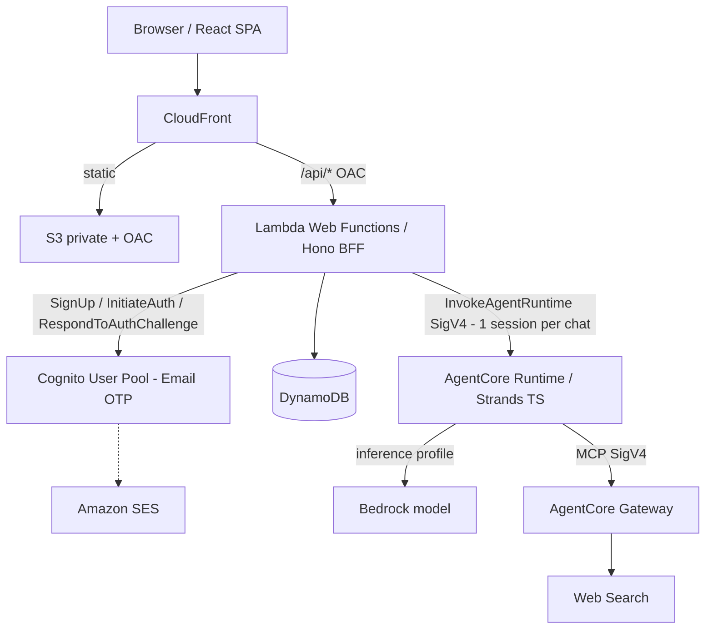

# AI Chat Starter Kit

ChatGPT風のテキストチャットWebアプリを、自分のAWSアカウント（東京リージョン中心）へデプロイして拡張するための**スターターキット**です。

- **フロント**: React + Vite + TypeScript / Tailwind / TanStack Query（SPA）
- **BFF**: Hono（Lambda Web Functions。代替: Function URL + Response Streaming）
- **認証**: メールアドレスとワンタイムコードだけのパスワードレス認証（Cognito メールOTP + 自前1画面）。ブラウザにトークンを渡さず `__Host-session` Cookie で管理
- **AI**: Strands Agents TypeScript SDK を Amazon Bedrock AgentCore Runtime にデプロイ。AgentCore Gateway の Web Search を既定で有効（出典を表示）
- **データ**: DynamoDB（会話・セッション・クォータの正本）
- **IaC**: AWS CDK v2（TypeScript）。WAF / Budgets / CI/CD / 独自ドメインは任意（既定OFF）
- **ローカル**: MiniStack + ローカルAgent（固定モデル・検索fixture）+ dev-auth。**AWS認証情報・APIキー・インターネット不要**で `pnpm dev` / `pnpm test` が完結

仕様: [`PRD/ai_chat_starter_kit_technical_spec_v2_1.md`](PRD/ai_chat_starter_kit_technical_spec_v2_1.md) ／ 設計判断: [`docs/adr/`](docs/adr/) ／ 運用: [`docs/operations.md`](docs/operations.md)



## クイックスタート（ローカル、AWSアカウント不要）

前提: **Node.js 24**、**pnpm 12**（`corepack enable`）、**Docker**（Docker Desktop または互換エンジン）。

```bash
git clone <this repo> && cd <repo>
pnpm install --frozen-lockfile
pnpm exec e2e-web install chromium --with-deps   # 初回のみ（E2E用のChromium。Linuxは --with-deps でOSライブラリも導入）
pnpm test                                          # lint → typecheck → Unit → API結合 → E2E（MiniStack自動起動）
pnpm dev                                           # http://localhost:5173 （web:5173, api:3000, agent:8080）
```

- ログイン画面で**任意のメールアドレス**を入力し、確認コード **`000000`** を入力します（ローカル専用の dev-auth。本番ビルドには含まれません）。
- 「最新」「検索」「ニュース」などを含む質問では、Web検索（固定fixture）と出典表示を確認できます。ローカルのAIは**固定文を返すモデル**で、外部LLMは呼びません。
- MiniStack はテスト後も起動したままです。停止: `pnpm infra:local:down`。
- 初回の依存パッケージ・Dockerイメージ（`ministackorg/ministack:1.5.33@sha256:b5818618…`）・Chromium の取得にはネットワークが必要です。取得後はオフラインで動作します。

### コマンド

| コマンド | 内容 |
|---|---|
| `pnpm dev` | MiniStack（未起動なら起動・seed）＋ web / api / agent を起動 |
| `pnpm test` | 全4階層を1コマンドで実行（`scripts/test-all.ts`） |
| `pnpm test:unit` | フロント（Vitest + RTL + MSW）・バック（api / agent / packages / infra）のUnit |
| `pnpm test:integration` | 実HTTP → Hono → MiniStack → ローカルAgent → 検索fixture |
| `pnpm test:e2e` | TesterArmy `e2e` + ローカルChromium（専用ポート・専用テーブル） |
| `pnpm test:e2e:exploratory` | `agent.act` 等のAI依存E2E（要モデル設定。`pnpm test` には含めない） |
| `pnpm test:coverage` | カバレッジ（重要ロジックは branch 80% 以上をしきい値に設定） |
| `pnpm lint` / `pnpm typecheck` | ESLint / `tsc -b` |
| `pnpm infra:local:up` / `infra:local:down` | MiniStack の起動・停止 |
| `pnpm local:seed` / `local:reset` | テーブル作成 / テスト用テーブルの作り直し |
| `pnpm build` | web / api（Node 24）/ agent（AgentCore Node 22 用ZIP）をビルド |
| `pnpm cdk:synth` / `cdk:diff` | ビルド → CDK synth / diff |
| `pnpm deploy:aws` | ビルド → `cdk deploy --all`（手動デプロイ） |
| `pnpm smoke` | デプロイ後の簡易スモークテスト |
| `pnpm test:aws-smoke` | AWS dev 受入試験（メール受信が必要） |
| `pnpm delete-user -- --email <addr> [--yes]` | 管理者用ユーザーデータ削除 |

## リポジトリ構成

```text
apps/web        React SPA（pages / components / hooks / api）
apps/api        Hono BFF。src/app.ts（共通）、src/server.ts（AWSアダプター）、src/local.ts（ローカル）
apps/agent      AgentCore Runtime。/ping, /invocations、Strands Runner、Gateway Web Search、fixture検索
packages/       contracts（Zod・SSE）、agent-contracts、auth（Cognito / dev-auth）、aws-clients、config、test-fixtures
infra/          CDK（bin, config, lib, optional, test）
local/          docker-compose（MiniStack）、preflight / seed / reset / launch、検索fixture
tests/          integration（MiniStack）、e2e（TesterArmy）、aws-smoke（AWS dev）
scripts/        build-api / build-agent / deploy / smoke / test-all / run-e2e / delete-user
docs/           ADR、脅威モデル、運用、独自ドメイン移行、プライバシーポリシー雛形
```

## 実行モードと fail-closed

| | local | aws |
|---|---|---|
| 認証 | dev-auth（固定コード `000000`） | Cognito メールOTP |
| AI | ローカルAgentプロセス（固定モデル） | AgentCore Runtime（Bedrock） |
| Web検索 | `local/fixtures/search/*.json` | AgentCore Gateway Web Search |
| AWS SDK | MiniStack（`http://localhost:4566`、ダミー認証情報） | 実AWS |

`APP_MODE=aws` で dev-auth・固定モデル・fixture・エンドポイント上書きを指定すると**起動時に失敗**します（`packages/config`）。`APP_MODE=local` は Lambda / AgentCore 上では起動しません。本番バンドルに dev-auth と固定モデルが含まれないことは `pnpm build` 時に検査します。

## AWS へのデプロイ（CI/CD なしが標準）

詳細は [`docs/operations.md`](docs/operations.md)。

1. IAM Identity Center 等でログインし、東京リージョン・Bedrock の選定モデル・推論プロファイルが使えるか、SCP でリージョンを制限していないかを確認する。
2. **SES**: 送信元メールアドレス（またはドメイン）を検証する。**本番公開前にサンドボックス解除を申請**する（サンドボックス中は検証済みアドレスにしか送れません）。送信元ドメインの DMARC が `p=reject` だと OTP メールが拒否されるため、自分のドメインを Easy DKIM 付きで検証して使うのが確実です（[運用手順](docs/operations.md)）。
3. `cp infra/deploy.config.example.json infra/deploy.config.json` で `sesFromEmail` 等を設定（git管理外）。
4. `pnpm test` → `pnpm cdk:diff` → `cdk bootstrap`（初回のみ）→ `pnpm deploy:aws`。
5. `pnpm smoke`、`pnpm test:aws-smoke` で受入確認し、出力された `AppUrl` を開く。

設定の集約先:

- `infra/config/options.ts` … `enableWaf` / `enableBudgets` / `enableCiCd` / `useCustomDomain` / `webSearchEnabled` / `bffPlatform`（既定は任意機能OFF、`web-functions`）
- `infra/config/app-config.ts` … モデルID、クォータ（20回/日・10回/時・検索20回/日、JST境界）、タイムアウト（生成120秒 < BFF150秒 < ロック180秒）、AgentCoreアイドル300秒、ログ保持30日

### 既定モデル

`jp.anthropic.claude-haiku-5-5`（JP推論プロファイル。推論は国内リージョンで実行）。アカウントによっては Claude 5 系が「not available for this account」となり別途の有効化が必要です。その場合は `deploy.config.json` の `modelId` を `jp.anthropic.claude-haiku-4-5-20251001-v1:0` 等の利用可能なプロファイルに変更してください（IAMは選定モデルのみを許可するよう自動で絞られます）。

## AWS dev での検証状況

PoC 関門（§15 Phase 0）と AWS dev 受入試験（§12.6）の結果は [ADR 0000](docs/adr/0000-poc-gate.md) にまとめています。概要:

- Lambda Web Functions: CloudFront + OAC 経由の POST・SSE 逐次配信・**ハートビートで125秒のストリーム**・中断検知・Revision 切り戻しがすべて合格 → `web-functions` を採用（[ADR 0001](docs/adr/0001-bff-platform.md)）
- Cognito: パスワードなし `SignUp`、`ConfirmSignUp` の Session による自動サインイン（新規はメール1通）、EMAIL_OTP サインイン（コードは8桁）、未確認ユーザーの再開
- AgentCore: Node.js ZIP デプロイ、SigV4 Invoke、会話単位セッション、`StopRuntimeSession`、Gateway Web Search（出典取得）、IAM のモデル限定
- `pnpm smoke` 8/8、`pnpm test:aws-smoke` 9/9

## 既知の制約

- **MiniStack は AgentCore Runtime / Gateway と Lambda Web Functions を再現できません。** ローカルはAgentをローカルプロセスで直接起動し、CDKはMiniStackへデプロイしません（`cdk synth` と AWS dev で検証）。
- **TesterArmy `e2e` は公開から日が浅く**、CLI・設定が変わる可能性があります（`e2e@0.21.3` / `@e2e-dev/web@0.15.3` に固定）。
- **Cognito の制約**: ユーザープールの第1要素から PASSWORD を外せません。App Client を `ALLOW_USER_AUTH` のみにし、ユーザーはパスワードなしで登録されるため、実際にはメールOTPでのみサインインできます（[ADR 0002](docs/adr/0002-passwordless-auth.md)）。
- **Web Search connector の版**は CloudFormation で指定できず、既定版（現在 1.3.0。入出力は1.2.0と互換）が使われます（[ADR 0003](docs/adr/0003-agentcore-web-search.md)）。
- **ローカルの Origin**: `APP_ORIGIN`（既定 `http://localhost:5173`）とブラウザのURLが一致しない場合、状態変更APIは403になります。Codespaces 等の転送URLで開く場合は `APP_ORIGIN=<そのURL> pnpm dev`。
- **ユーザー単位の全セッション即時失効は未実装**です（最大8時間有効）。緊急時はセッションテーブル全体を消去して全ユーザーをログアウトします（`docs/operations.md`）。
- 退会の画面機能はありません（`pnpm delete-user`）。
- Cognito のサインインコードのメール件名・本文は既定文面（英語）のままです（確認コードのメールは日本語テンプレート）。
- `enableDiagnostics`（既定OFF）は PoC 用の診断SSE（`/api/v1/diagnostics/stream`）を有効にします。検証後は必ずOFFに戻してください。

## 一般公開して運用する場合の注意（キット利用者の責任範囲）

- **コスト上限（キルスイッチ）は実装していません。** ユーザー単位のクォータはありますが、アカウントの大量作成でクォータを回避され得ます。全体の上限、`enableBudgets`、`enableWaf` を検討してください。AWS Budgets は支出を即時停止しません。
- **Web Search は別途従量課金**です（目安 $7 / 1,000 検索。[§14](PRD/ai_chat_starter_kit_technical_spec_v2_1.md)）。AgentCore Runtime / Gateway、Bedrock、Cognito（MAU）、SES（ログインごとに1通）も従量課金です。
- **アカウントの強度はメールアカウントの安全性に依存**します。
- 検索結果の出典表示が利用条件です。キットは出典（タイトル・URL・公開日）の表示まで実装しています。

## データの所在

- 会話データ（DynamoDB）・アプリログ（CloudWatch）は **東京リージョン** に保存します。
- **推論処理は選定した推論プロファイルにより東京以外（国内他リージョン・海外）で行われ得ます**（JPプロファイルは国内、Globalプロファイルは海外を含む）。
- **Web検索のクエリは検索事業者へ送られ得ます。**
- PITR により削除後も最大35日間データが残ります。
- これらを [`docs/privacy-policy-template.md`](docs/privacy-policy-template.md) に記載しています。

## テスト戦略

| レベル | 対象 | ツール |
|---|---|---|
| Frontend Unit | 画面・SSEパーサー・XSS・出典・ログイン画面 | Vitest + RTL + user-event + MSW（ネットワーク禁止） |
| Backend Unit | 認証フロー・セッション・Origin・所有者・冪等性・ロック・遅延回復・クォータ（JST）・SSE・Agent | Vitest（インメモリリポジトリ・fake clock） |
| API 結合 | 実HTTP・DynamoDB副作用・SSE・切断・再起動後の復元 | Vitest + MiniStack |
| System E2E | ログイン→送信→逐次表示→出典→リロード復元→削除→ログアウト、XSS、429、切断 | TesterArmy `e2e` + Chromium |
| AWS dev 受入 | Cognito OTP、CloudFront/OAC、SSE、AgentCore、Web Search、分離 | `pnpm smoke` / `pnpm test:aws-smoke` |

## 拡張のヒント

- 観測性: AgentCore Observability（トレース）は CloudWatch Transaction Search の有効化と ADOT の導入で追加できます（`docs/operations.md`）。
- 将来候補: パスキー（独自ドメイン導入時）、Googleログイン、全体コスト上限、ユーザー単位のセッション失効、退会画面。

## ライセンス

[MIT](LICENSE)
